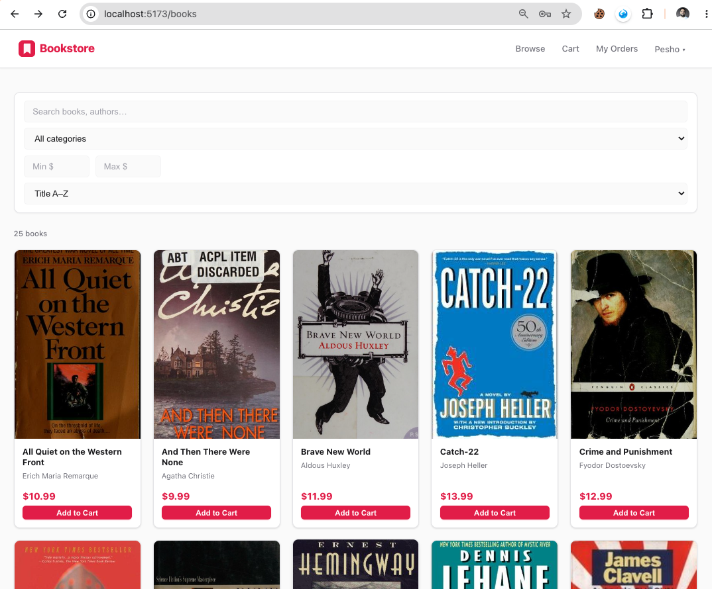
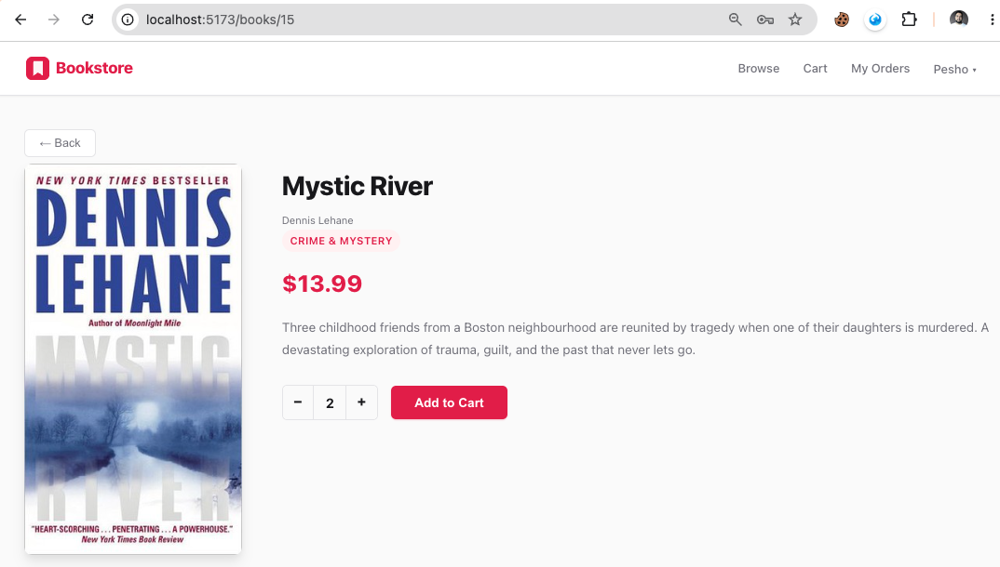
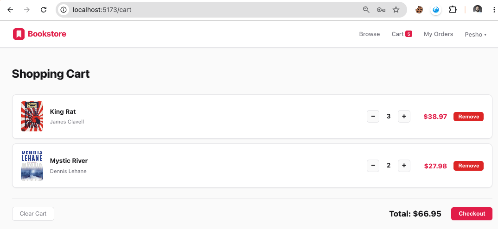
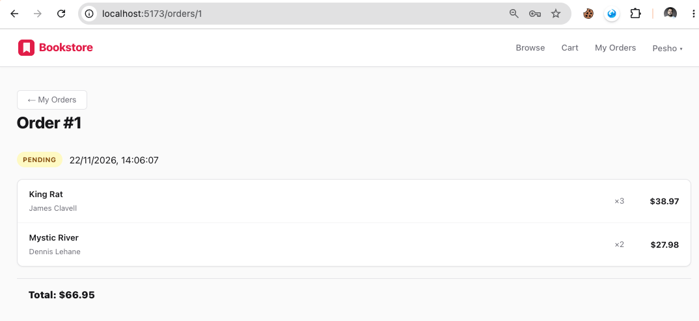
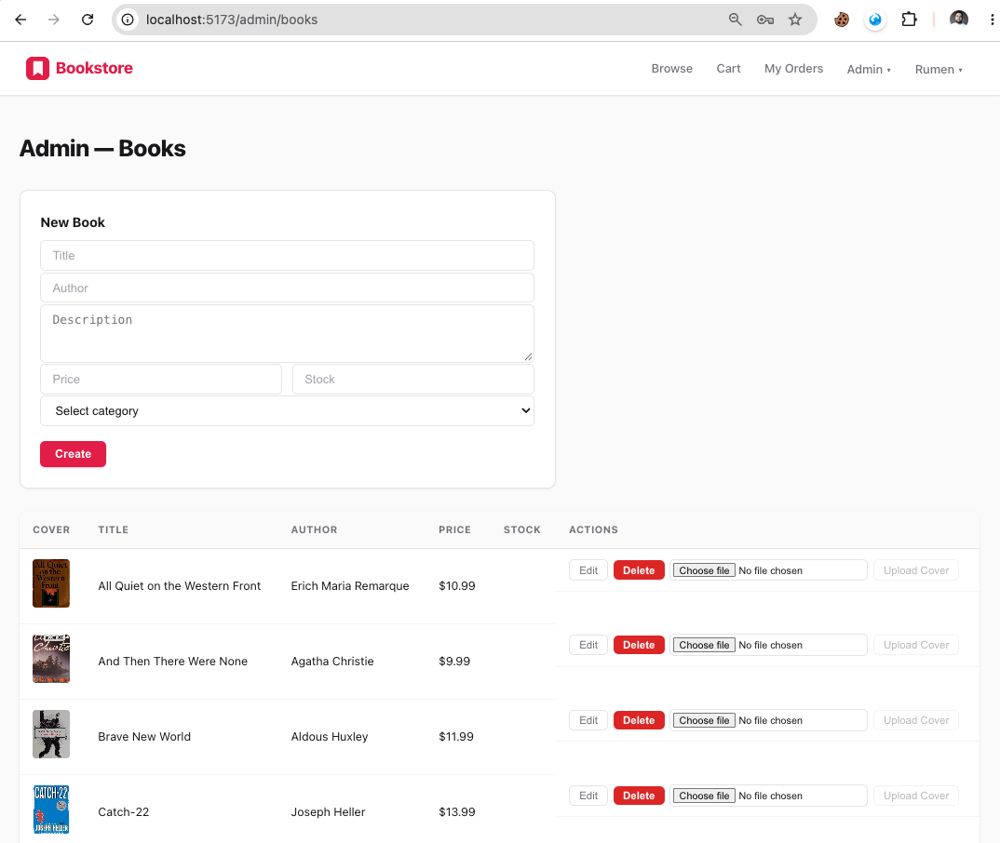
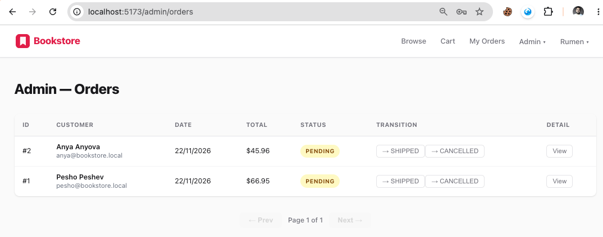

# Online Bookstore Service

A full-stack online bookstore where users browse, search, and purchase books, and
admins manage inventory, categories, and orders. A Spring Boot REST backend
(MySQL + Redis) with a React + TypeScript single-page frontend.

- **Backend:** stateless JWT auth, role-based access, partial-fulfillment order
  engine with optimistic locking, Redis-cached catalog, Flyway-managed schema,
  Cloudinary cover hosting, and interactive OpenAPI docs.
- **Frontend:** React 19 SPA (Vite) with browse/search, cart, checkout, order
  history, profile, and an admin panel.

> Database ER diagram: [`plans/diagrams/bookstore-erd.png`](plans/diagrams/bookstore-erd.png)
> · UI screenshots: [`plans/screenshots/`](plans/screenshots/)
> · interactive API docs at `/swagger-ui.html` when the app is running.

---

## Screenshots

| Browse | Book detail | Cart |
|---|---|---|
|  |  |  |

| Order detail | Admin — Books | Admin — Orders |
|---|---|---|
|  |  |  |

More in [`plans/screenshots/`](plans/screenshots/).

---

## Tech Stack

| Layer | Technology |
|---|---|
| Language | Java 21 |
| Framework | Spring Boot 3.4.1 (Gradle Kotlin DSL) |
| Security | Spring Security 6, JWT (jjwt 0.12.6), BCrypt (`DelegatingPasswordEncoder`) |
| Persistence | Spring Data JPA (Hibernate), custom repositories (`EntityManager` / Criteria API) |
| Database | MySQL 8, schema versioned with Flyway |
| Caching | Redis 7, Spring Cache (JSON serialization, 5-min TTL) |
| Rate limiting | Bucket4j 8.10 (Redis-backed) |
| Image hosting | Cloudinary CDN |
| API docs | springdoc-openapi 2.8.6 (Swagger UI) |
| Frontend | React 19 + TypeScript, Vite, react-router v7, Zustand, Axios |
| Containers | Docker Compose (MySQL + Redis infra); Dockerfiles for backend + nginx frontend |

**Design rules (enforced throughout):** no Lombok · no `CrudRepository`
auto-queries (custom repositories only) · controllers → services → repositories →
domain · services return DTOs, never entities · `@Transactional` only on service
methods · `BigDecimal` for money · `Instant` for timestamps.

---

## Features

### Users & Auth
- Register / login issue a stateless JWT (24h default); logout blocklists the token server-side (Redis).
- Roles: `USER` and `ADMIN`, enforced with method-level `@PreAuthorize`.
- Profile: view/update name, change password. Changing the password invalidates
  all prior tokens (a DB-side `token_valid_after` cutoff) and blocklists the
  current one — the user must log in again.

### Catalog
- Books: dynamic search/filter by `query`, `categoryId`, `minPrice`, `maxPrice`
  with pagination and sorting (Criteria API). Soft-delete preserves order history.
- Admin CRUD on books and categories; per-book cover upload to Cloudinary.
- Catalog reads are Redis-cached and evicted on any stock/catalog mutation.

### Cart
- One cart per user; add/update/remove/clear items.
- Guards: out-of-stock rejection, 100-distinct-item cap, quantity ≤ available stock.
- Loaded with `JOIN FETCH` to avoid N+1 queries.

### Orders — partial fulfillment
Placing an order makes a single pass over the cart:

| Cart line | Result |
|---|---|
| in stock (stock ≥ requested) | fulfilled fully |
| partial (0 < stock < requested) | capped to available; adjustment recorded |
| out of stock (stock = 0) | skipped; adjustment recorded |

If nothing can be fulfilled, no order is created (`400`). Otherwise the order is
saved `PENDING`, the cart is cleared, and the response lists any `adjustments`.
`priceAtPurchase` is snapshotted per item so later price changes don't affect
past orders.

**Status state machine** (admin-driven): `PENDING → {SHIPPED, CANCELLED}`,
`SHIPPED → {DELIVERED, CANCELLED}`, `DELIVERED`/`CANCELLED` are terminal.
Cancelling restores stock for still-active (non-soft-deleted) books.

Concurrency is handled at the database via JPA `@Version` optimistic locking on
`Book` and `Order`; conflicting order placements/updates retry up to 3 times.

---

## API Overview

Base URL `http://localhost:8080`. Full interactive reference at
**`/swagger-ui.html`**.

| Method | Endpoint | Access | Description |
|---|---|---|---|
| POST | `/api/auth/register` | public | Create account, returns JWT |
| POST | `/api/auth/login` | public | Authenticate, returns JWT |
| POST | `/api/auth/logout` | auth | Blocklist the current token |
| GET | `/api/users/me` | auth | Current user profile |
| PUT | `/api/users/me` | auth | Update first/last name |
| PATCH | `/api/users/me/password` | auth | Change password (invalidates tokens) |
| GET | `/api/categories`, `/api/categories/{id}` | public | List / get category |
| POST / PUT / DELETE | `/api/categories`, `/api/categories/{id}` | ADMIN | Manage categories |
| GET | `/api/books` | auth | Search/filter/paginate books |
| GET | `/api/books/{id}` | auth | Book detail |
| POST / PUT / DELETE | `/api/books`, `/api/books/{id}` | ADMIN | Manage books (DELETE = soft) |
| POST | `/api/books/{id}/cover` | ADMIN | Upload cover (multipart) → Cloudinary |
| GET | `/api/cart` | auth | View cart |
| POST | `/api/cart/items` | auth | Add item |
| PUT | `/api/cart/items/{bookId}` | auth | Update quantity |
| DELETE | `/api/cart/items/{bookId}` | auth | Remove item |
| DELETE | `/api/cart` | auth | Clear cart |
| POST | `/api/orders` | auth | Place order from cart |
| GET | `/api/orders/my` | auth | Own order history |
| GET | `/api/orders/{id}` | auth | Order detail (own, or any for ADMIN) |
| GET | `/api/orders` | ADMIN | All orders, paginated |
| PATCH | `/api/orders/{id}/status` | ADMIN | Transition order status |

---

## Getting Started

### Prerequisites
- Docker + Docker Compose (MySQL + Redis run in containers).
- For running the backend locally: Java 21+. For the frontend dev server: Node 22+.

### 1. Configure environment

```bash
cp .env.example .env
# Fill in DB_USERNAME / DB_PASSWORD, JWT_SECRET, and Cloudinary credentials.
# .env is gitignored — never commit real secrets.
```

### 2. Local development (recommended)

Infra in Docker, backend on the host for fast feedback:

```bash
docker compose up -d db redis                 # start MySQL + Redis
./gradlew bootRun --args='--spring.profiles.active=dev,local'
```

The `dev` profile also loads seed data (users + catalog). The API is at
`http://localhost:8080`.

Frontend dev server (separate terminal):

```bash
cd frontend
npm install
npm run dev          # http://localhost:5173, proxies /api → :8080
```

### 3. Container images (optional)

`docker-compose.yml` runs **only the MySQL + Redis infrastructure** (see steps 1–2).
The backend and frontend each have a Dockerfile that can be built and run
directly, but they are **not** wired into Compose yet:

```bash
docker build -t bookstore-backend .            # Spring Boot fat jar → :8080
docker build -t bookstore-frontend ./frontend  # React build served by nginx → :80
```

`frontend/nginx.conf` serves the SPA and proxies `/api/` to an `app:8080`
upstream, so a full containerised stack would add `app` + `frontend` services to
`docker-compose.yml` building these images.

| Service | URL |
|---|---|
| Backend | http://localhost:8080 |
| Swagger UI | http://localhost:8080/swagger-ui.html |
| Frontend (Vite dev) | http://localhost:5173 |

### Seeded accounts (dev profile only, password `12345678`)

| Email | Role |
|---|---|
| `pesho@bookstore.local` | USER |
| `anya@bookstore.local` | USER |
| `rumen@bookstore.local` | ADMIN |

---

## Database

Schema is managed by Flyway and never auto-generated (`ddl-auto` is off).

```
src/main/resources/db/
├── migration/
│   └── V1__baseline_schema.sql     # all tables, indexes, constraints (prod + tests)
└── seed/                           # dev-only, loaded via the `dev` profile
    ├── V1001__seed_users.sql       # 3 demo users
    └── V1002__seed_catalog.sql     # 6 categories + 23 books (Cloudinary covers)
```

`application.yml` points Flyway at `classpath:db/migration` only (schema, prod-safe);
`application-dev.yml` adds `classpath:db/seed` so seeds apply only in dev. The seed
version band (`V1001+`) is kept clear of the schema band so they never collide.

**Entities:** `User`, `Category`, `Book`, `Cart`, `CartItem`, `Order`, `OrderItem`.
See the ER diagram and regeneration notes in
[`plans/diagrams/`](plans/diagrams/).

---

## Testing

```bash
./gradlew test
```

- **MVC slice tests** (`@WebMvcTest`) for controller/security behavior.
- **Integration tests** spin up real MySQL and Redis via Testcontainers and run
  against the `db/migration` schema (no seed data), so the baseline migration must
  stand alone.

> Testcontainers is pinned to 1.21.4 for compatibility with Docker Engine 29.

---

## Project Layout

```
.
├── src/main/java/com/bookstore/bookstore/
│   ├── config/        # SecurityConfig, CacheConfig, OpenApiConfig, CloudinaryConfig, RateLimitConfig
│   ├── security/      # JwtTokenProvider, JwtAuthenticationFilter, RateLimitFilter, UserDetailsServiceImpl
│   ├── domain/        # JPA entities + enums (Role, OrderStatus)
│   ├── repository/    # interfaces + EntityManager/Criteria implementations
│   ├── service/       # BookService, CartService, OrderService, OrderPlacer, OrderStatusUpdater, ...
│   ├── controller/    # REST controllers
│   ├── dto/           # request/ and response/ DTOs (+ PageResponse<T>, ErrorResponse)
│   └── exception/     # domain exceptions + GlobalExceptionHandler
├── src/main/resources/
│   ├── db/            # Flyway migration/ + seed/
│   └── application*.yml
├── frontend/          # React + TypeScript + Vite SPA (see frontend/README.md)
├── plans/             # design notes, guides, and the ER diagram
├── docker-compose.yml
└── build.gradle.kts
```

Deeper design notes live in [`plans/`](plans/) — e.g.
[implementation plan](plans/bookstore-backend-implementation.md),
[concurrency & stock protection](plans/concurrency-and-stock-protection.md),
[partial order fulfillment](plans/order-fulfillment-v2-partial-with-adjustments.md),
and the [frontend UI guide](plans/frontend-ui-guide.md).
