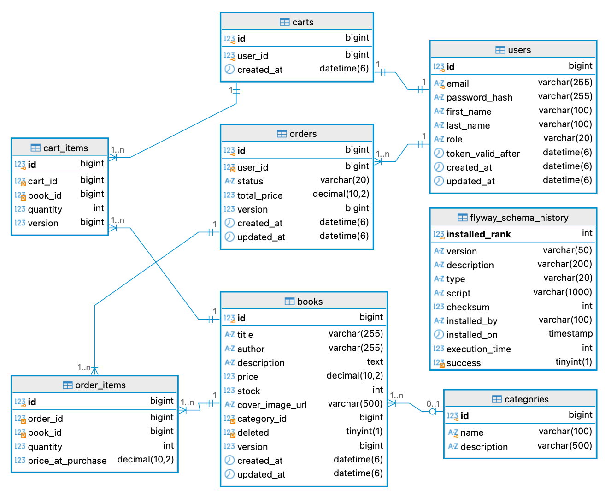
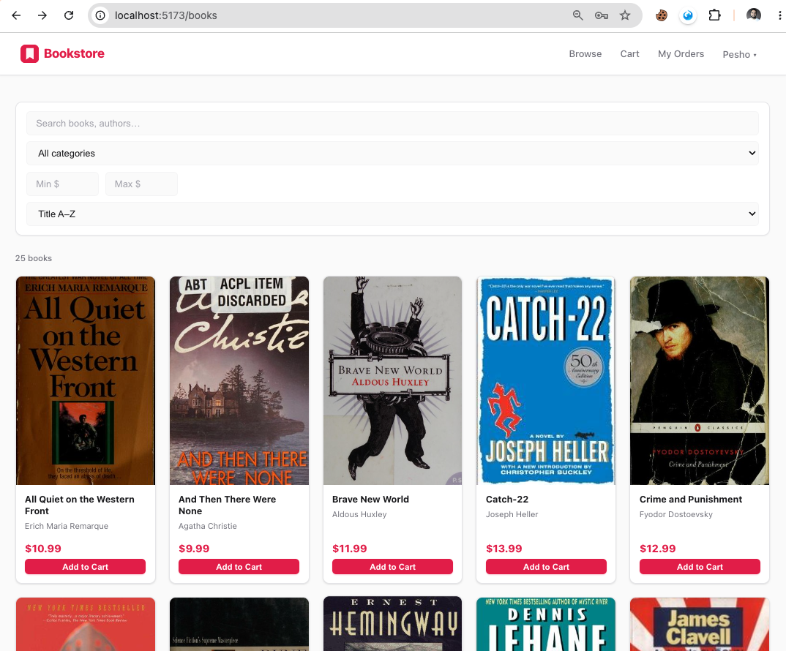
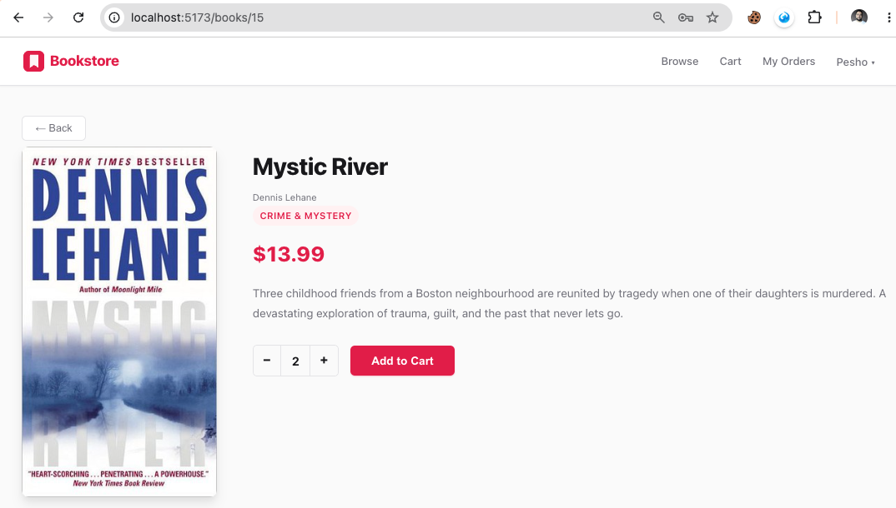
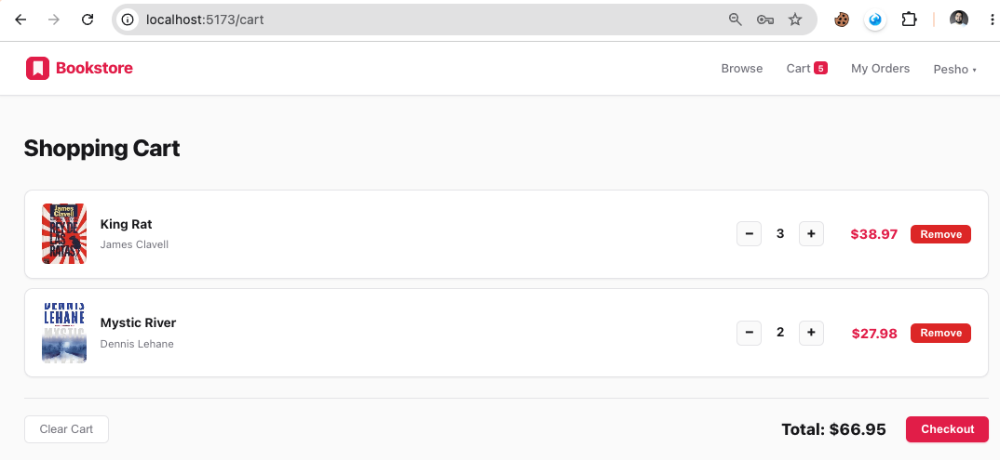
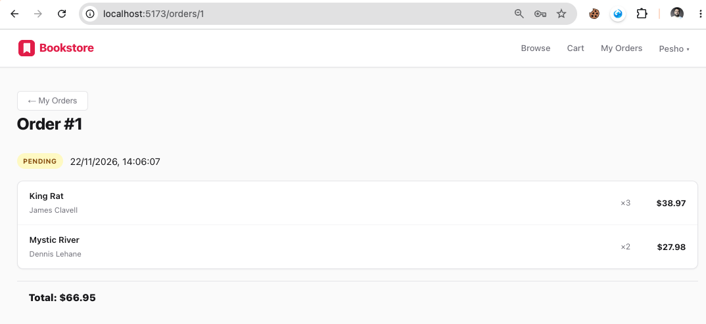
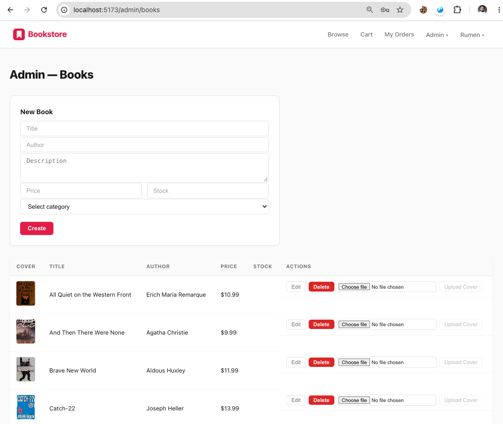
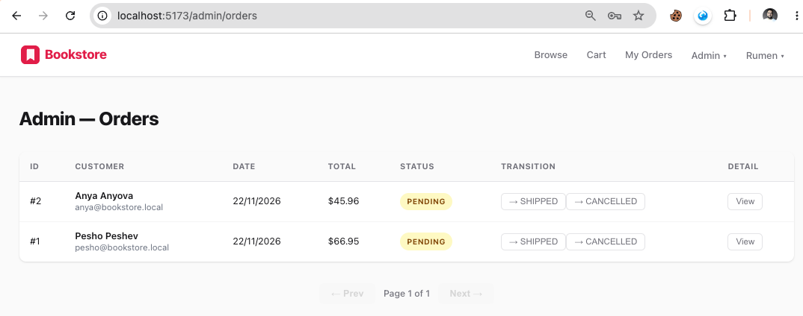

# Solution Overview — Online Bookstore Service

A full-stack online bookstore: customers browse and search a catalogue, manage
a cart, and place orders; admins manage inventory, categories, and order
fulfilment. The system is a **fully RESTful, stateless Spring Boot API**
(MySQL + Redis) consumed by **two interchangeable clients**: a **React +
TypeScript single-page app** and, equivalently, any HTTP client (Swagger UI,
`curl`, Postman) — because the API is the single source of truth, the SPA uses
nothing the test guide and Swagger don't. Docker Compose brings up the MySQL +
Redis infrastructure with one command, and the backend and frontend run on the
host for fast iteration.

The HTTP contract follows REST conventions throughout: **resource-oriented
URIs** (`/api/books`, `/api/orders/{id}`, `/api/cart/items/{bookId}`), **proper
verb semantics** (GET read-only, POST create → `201`, PUT/PATCH update, DELETE →
`204`), **meaningful status codes** (`400/401/403/404/409/429`), **stateless
auth** (a Bearer JWT on every request, no server session), and a **consistent
JSON envelope** (`PageResponse<T>` for collections, a uniform `ErrorResponse`
for failures).

This document explains *what* we built, *why* we made the architectural
choices we did, *what problems they solve*, and *how to run and explore it*.

---

## 1. Technology Choices (and why)

| Area | Technology | Why this choice |
|---|---|---|
| Language / runtime | **Java 21** | Modern LTS; records for DTOs, pattern matching, virtual-thread-ready. |
| Framework | **Spring Boot 3.4.1** (Gradle Kotlin DSL) | Mature REST + security + data stack; convention over configuration. |
| Security | **Spring Security 6 + JWT** (jjwt 0.12.6) | Stateless auth that scales horizontally with no server-side session store. |
| Persistence | **Spring Data JPA / Hibernate** with hand-written repositories | ORM for mapping, but **no `CrudRepository` auto-queries** — every query is explicit (`EntityManager` / Criteria API) for full control and no surprise N+1s. |
| Database | **MySQL 8 (InnoDB)** | Relational integrity, row-level locking, mature tooling. Schema versioned with **Flyway**. |
| Cache / coordination | **Redis 7** | Three jobs: catalogue read cache, JWT logout blocklist, and distributed rate-limit buckets. |
| Rate limiting | **Bucket4j 8.10 (Redis-backed)** | Token-bucket limits that are shared across app instances. |
| Image hosting | **Cloudinary CDN** | Offloads book-cover storage/serving from the app; no binary blobs in the DB. |
| API docs | **springdoc-openapi 2.8.6** | Live, interactive Swagger UI at `/swagger-ui.html`. |
| Frontend | **React 19 + TypeScript + Vite**, react-router v7, **Zustand**, Axios | Fast SPA with typed API calls, persisted auth/cart state, and a thin Bearer-token interceptor. |
| Packaging | **Docker + Docker Compose** | One command (`docker compose up`) brings up the MySQL + Redis infrastructure; the backend and frontend run on the host. Production Dockerfiles for both also exist (see §5). |

**Design rules enforced throughout:** no Lombok · custom repositories only (no
auto-derived queries) · strict layering `controller → service → repository →
domain` · services return **DTOs, never entities** · `@Transactional` lives on
service methods only · `BigDecimal` for money · `Instant` for timestamps.

---

## 2. Architecture

### 2.1 Layering

```
React SPA ──HTTP/JSON──► Controllers ──► Services ──► Repositories ──► MySQL
   (Vite / nginx)          (DTO in/out)   (@Transactional)  (Criteria/JPQL)
                               │                │
                               │                └──► Redis (cache / blocklist / rate limit)
                               └──► Cloudinary (cover uploads)
```

Controllers only translate HTTP ⇄ DTOs. Services own all business rules and
transactions. Repositories own all SQL/JPQL. Entities never leave the service
layer — responses are DTOs, so the API shape is decoupled from the schema.

**Fully RESTful by design.** The frontend is *only a client* — it holds no
business logic the API doesn't enforce, so the exact same operations are
reachable from the React SPA, Swagger UI, or `curl`. Resources map to nouns,
HTTP verbs carry the intent, and responses use conventional status codes and a
uniform JSON shape (see the [API overview in the README](../README.md#api-overview)).
This equivalence is what the [happy-path test guide](happy-path-test-guide.md)
exercises end-to-end against the raw API.

### 2.2 Authentication — stateless JWT

- Register / login return a signed **JWT** (HS/HMAC, 24 h default) carrying the
  user's email (`sub`), a random `jti`, and a `role` claim.
- Every request passes through `JwtAuthenticationFilter`, which verifies the
  signature and establishes the security context — **no server-side session**,
  so any instance can serve any request.
- **Logout** is handled by blocklisting the token's `jti` in Redis with a TTL
  equal to the token's remaining lifetime (self-expiring, no cleanup job).
- **Password change** invalidates *all* previously issued tokens via a DB-side
  `token_valid_after` cutoff the filter checks on every request, and
  blocklists the current token — forcing re-login everywhere.
- **Rate limiting** (`RateLimitFilter`, Bucket4j/Redis): login, register, and
  password-change are capped at **5 requests/minute per IP+path**; exceeding
  returns `429` with `Retry-After`. `X-Forwarded-For` is only trusted from
  loopback, so clients can't spoof their IP.

### 2.3 Problem we solve well: concurrency & overselling

Two customers can buy the last copy of a book at the same millisecond. We must
never let stock go negative, **even across multiple app instances**.

Java `synchronized` is insufficient — it only locks within one JVM; two
instances behind a load balancer would still collide. **The database is the one
component every instance shares, so it is the enforcer.**

Three layers cooperate:

| Layer | Responsibility |
|---|---|
| `@Transactional` (service) | Atomic unit — any failure rolls the whole order back. |
| JPA `@Version` on `Book` / `Order` / `CartItem` | Adds `WHERE version = ?` to every UPDATE — the optimistic-lock write guard that detects a lost race (`0 rows affected` → `OptimisticLockException`). |
| MySQL InnoDB row locking | Physically serialises concurrent writes to the same row. |

On a detected collision, `OrderService` **retries the transaction up to 3
times** (re-reading current stock each attempt — the loser of a race may still
succeed, possibly as a partial fulfilment). Only after 3 failures does the user
get a `400`. The same retry guards admin order-status updates.

### 2.4 Problem we solve well: partial order fulfilment

Rather than all-or-nothing, placing an order makes a single pass over the cart:

| Cart line | Result |
|---|---|
| stock ≥ requested | fulfilled fully |
| 0 < stock < requested | capped to available; an **adjustment** is recorded |
| stock = 0 | skipped; an adjustment is recorded |

If nothing can be fulfilled, no order is created (`400`). Otherwise the order is
saved `PENDING`, the cart is cleared, and the response lists the `adjustments`
so the UI can explain exactly what changed. Each `OrderItem` snapshots
`priceAtPurchase`, so later price edits never rewrite order history.

**Status state machine** (admin-driven): `PENDING → {SHIPPED, CANCELLED}`,
`SHIPPED → {DELIVERED, CANCELLED}`; `DELIVERED`/`CANCELLED` are terminal.
Cancelling restores stock for books that haven't been soft-deleted.

### 2.5 Performance decisions under load

- **HikariCP pool** tuned explicitly (max 20, min-idle 5, fail-fast 10 s,
  recycle every 10 min) instead of the default 10 — prevents a starved pool
  from hanging all 200 Tomcat threads.
- **Everything paginated** — `GET /api/books` and both order-listing endpoints
  return a `PageResponse<T>`, so a single admin request can never load the
  whole table into heap.
- **Redis catalogue cache** — `BookService.search` is `@Cacheable` (5-min TTL,
  JSON), evicted on any stock/catalogue mutation; gracefully degrades to the DB
  if Redis misbehaves.
- **JDBC batching** (`batch_size: 25`, `order_updates`) groups bulk UPDATEs —
  e.g. stock decrements and `@Version` bumps across several rows when an order
  flushes — into fewer round trips. (Inserts are not batched: every entity uses
  MySQL `AUTO_INCREMENT` / JPA `IDENTITY`, which forces Hibernate to execute each
  INSERT individually to read back the generated key.)
- **Soft delete** on books (`deleted` flag) preserves order history and lets
  cancellation know which books are still restockable.

---

## 3. Database

Schema is owned by **Flyway** and never auto-generated (`ddl-auto: validate`).

```
src/main/resources/db/
├── migration/
│   └── V1__baseline_schema.sql     # all tables, indexes, constraints (prod + tests)
└── seed/                           # dev-only, loaded via the `dev` profile
    ├── V1001__seed_users.sql       # 3 demo users
    └── V1002__seed_catalog.sql     # 6 categories + 23 books (Cloudinary covers)
```

Schema (low version numbers) and seed data (the `V1001+` band) live in separate
Flyway locations so data can never collide with or leak into a production
migration. `application.yml` points Flyway at `db/migration` only;
`application-dev.yml` adds `db/seed`, so **only the `dev` profile seeds data**.
Production and the Testcontainers integration tests apply `V1` alone — which is
why the baseline must be self-sufficient.

**Entities:** `User`, `Category`, `Book`, `Cart`, `CartItem`, `Order`,
`OrderItem`. Key constraints: unique `users.email`, unique `(cart_id, book_id)`,
`CHECK` constraints on role/status enums and non-negative stock / positive
quantities, and FKs with deliberate `ON DELETE` behaviour (cascade carts/items,
restrict orders, set-null book category).

### ER Diagram



Full-resolution raster and vector copies, plus regeneration steps, live in
[`diagrams/`](diagrams/). The diagram is reverse-engineered from the live
`bookstore` MySQL schema with DBeaver.

---

## 4. Frontend

A **React 19 + TypeScript** SPA (Vite) consuming the REST API. It is one of two
first-class clients — a convenient UI over exactly the same endpoints the
[happy-path test guide](happy-path-test-guide.md) and Swagger UI drive directly.

- **State:** Zustand stores for auth and cart, persisted to `localStorage`;
  an Axios interceptor attaches the `Bearer` token to every request.
- **Routing:** react-router v7 — public catalogue, auth-gated cart/checkout/
  orders/profile, and an admin-only panel (shown only for `ADMIN`).
- **Pages:** catalogue browse (search + category/price filters + sort), book
  detail, cart, order history + detail, profile, and admin management of books,
  categories, and orders (with inline status transitions and cover upload).

Screenshots of every page are in [`screenshots/`](screenshots/):

| | | |
|---|---|---|
|  |  |  |
|  |  |  |

---

## 5. What Docker Does

`docker-compose.yml` defines the two **infrastructure** services the app depends
on — it does **not** currently run the app or frontend itself:

| Service | Image | Container | Port | Role |
|---|---|---|---|---|
| `db` | `mysql:8.0` | `bookstore-db` | `3306` | Primary datastore; data persisted in the `mysql_data` volume; `mysqladmin ping` healthcheck. |
| `redis` | `redis:7-alpine` | `bookstore-redis` | `6379` | Cache + blocklist + rate-limit buckets; append-only persistence in `redis_data`; `redis-cli ping` healthcheck. |

- DB credentials and the database name come from **environment variables**
  (`DB_USERNAME`, `DB_PASSWORD`, `MYSQL_DATABASE=bookstore`, etc.) supplied via
  `.env` — **no secrets are committed**.
- Data survives container restarts via the named volumes. To wipe and reseed:
  `docker compose down -v && docker compose up` then restart the app.

**Container images for the app also exist** but are not wired into Compose:
- `Dockerfile` — multi-stage build of the Spring Boot backend (Temurin 21), runs
  the fat jar on `8080`.
- `frontend/Dockerfile` — builds the React app and serves it with **nginx** on
  `80`, proxying `/api/` to the backend (`frontend/nginx.conf`, upstream `app:8080`).

So today you run `docker compose up -d db redis` for infrastructure and start the
backend (`./gradlew bootRun`) and frontend (`npm run dev`) on the host — see §7.
A fully containerised stack would mean adding `app` and `frontend` services to
`docker-compose.yml` that build those two Dockerfiles; that wiring is not in
place yet.

---

## 6. Users in the Database (dev seed)

The `dev` profile seeds three demo accounts (all password **`12345678`**):

| Email | Role | Can do |
|---|---|---|
| `pesho@bookstore.local` | USER | Browse, cart, checkout, own orders, profile |
| `anya@bookstore.local`  | USER | Same as above |
| `rumen@bookstore.local` | ADMIN | All of the above **+** manage books, categories, and all orders |

Passwords are stored as bcrypt hashes (`DelegatingPasswordEncoder`, so legacy
hashes verify transparently). These accounts exist **only** when the `dev`
profile is active — they never ship to production.

---

## 7. Running & Exploring the Solution

### Prerequisites
- Docker + Docker Compose. For host-side backend: Java 21+. For the frontend
  dev server: Node 22+.

### Configure secrets (once)
```bash
cp .env.example .env
# Fill in DB_USERNAME / DB_PASSWORD, JWT_SECRET, and Cloudinary credentials.
# .env is gitignored — never commit real secrets.
```

### Run it (local development)
```bash
docker compose up -d db redis                                   # infra only
./gradlew bootRun --args='--spring.profiles.active=dev,local'   # seeds data
cd frontend && npm install && npm run dev                       # http://localhost:5173
```

### Build the container images (optional)
The backend and frontend Dockerfiles can be built and run directly (e.g. for a
production-like check), though they are not yet wired into `docker-compose.yml`:
```bash
docker build -t bookstore-backend .          # Spring Boot fat jar → :8080
docker build -t bookstore-frontend ./frontend # React build served by nginx → :80
```

### URLs
| What | URL |
|---|---|
| Backend API | http://localhost:8080 |
| Swagger UI | http://localhost:8080/swagger-ui.html |
| Frontend (Vite dev server) | http://localhost:5173 |
| Frontend (nginx image, if run) | http://localhost (port 80) |

### How to log in and look around
1. Open the frontend and click **Login**.
2. Sign in as **`pesho@bookstore.local` / `12345678`** to browse the catalogue,
   add books to the cart, and place an order — then view it under **My Orders**.
3. Log out and sign in as **`rumen@bookstore.local` / `12345678`** (ADMIN) to
   see the **Admin** menu: create/edit/delete books, upload covers, manage
   categories, and transition order statuses (e.g. `PENDING → SHIPPED`).
4. Prefer the API directly? Open **Swagger UI**, call `POST /api/auth/login`,
   copy the returned token into the **Authorize** dialog (`Bearer <token>`),
   and exercise any endpoint.
5. Inspect the database directly with DBeaver / Sequel Ace / `mysql` CLI at
   `localhost:3306`, db `bookstore` — see
   [`database-connection-guide.md`](database-connection-guide.md).

---

## 8. Testing

```bash
./gradlew test
```

- **MVC slice tests** (`@WebMvcTest`) cover controller + security behaviour with
  no infrastructure.
- **Unit tests** (Mockito) cover cart and order service logic in isolation.
- **Integration tests** spin up real MySQL and Redis via **Testcontainers** and
  run against the `db/migration` schema (no seed data), proving the baseline
  migration stands alone.

> Testcontainers is pinned to 1.21.4 for Docker Engine 29 compatibility.

For a manual, click-by-click (or `curl`-by-`curl`) walkthrough of **every**
endpoint — register, rate limiting, cart, partial-fulfilment orders, admin
flows, access-control and validation checks — follow the
**[happy-path test guide](happy-path-test-guide.md)**. It doubles as living
proof that the API is fully RESTful and self-sufficient without the SPA.

---

## 9. Further Reading

Deeper design notes live alongside this document in [`./`](.):
- [Backend implementation plan](bookstore-backend-implementation.md)
- [Concurrency & stock protection](concurrency-and-stock-protection.md)
- [Partial order fulfilment](order-fulfillment-v2-partial-with-adjustments.md)
- [High-traffic bottleneck analysis](high-traffic-bottleneck-analysis.md)
- [Happy-path manual test guide](happy-path-test-guide.md) — every endpoint via curl / Swagger
- [Frontend UI guide](frontend-ui-guide.md)
- [Database connection guide](database-connection-guide.md)

> Note: a few of the older plan documents were drafted against an earlier
> PostgreSQL design and still mention `postgres`/`V1__init`/fragmented
> migrations. The shipping system is **MySQL 8** with a single consolidated
> `V1__baseline_schema.sql` baseline; this overview reflects the current code.
